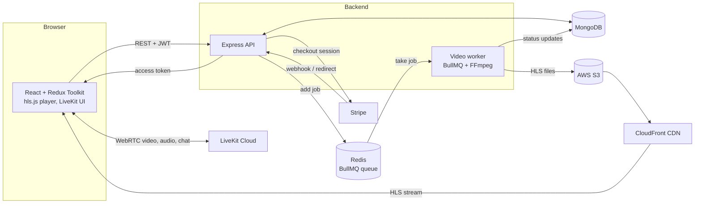
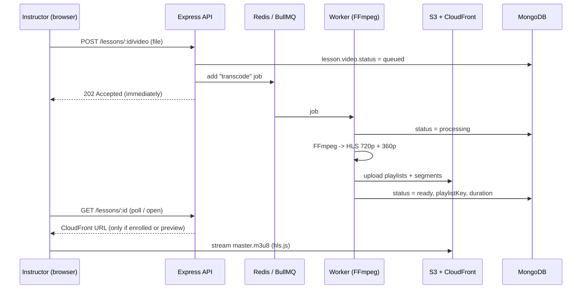
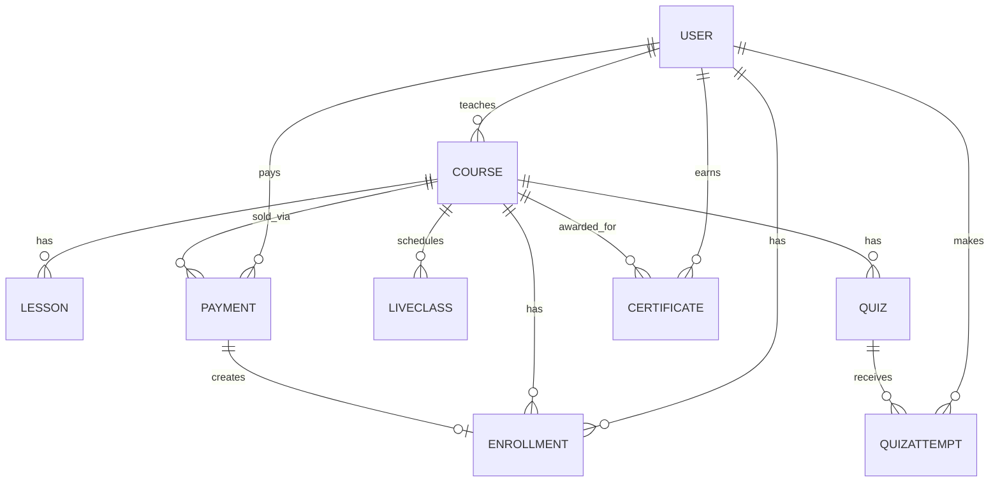

# Architecture

## System overview

## Video pipeline

Why a queue: FFmpeg can take minutes and uses a lot of CPU. The API answers instantly and the worker runs in a
separate process, so uploads never slow down browsing. If FFmpeg fails the job is retried once; after that the
lesson is marked `failed` and the instructor sees the error.

## Data model

Key decisions:
- **Money is stored as integer cents.** The platform fee and the instructor's share are frozen on each Payment at creation, so changing the fee later does not rewrite history.
- **Enrollment** is unique per (user, course) and stores completed lessons, passed quizzes and a progress percentage.
- **Certificates copy the names** of student, course and instructor, so they stay valid if a course is renamed or deleted.
- **Video URLs are only returned by `GET /lessons/:id`** after an access check (owner, admin, enrolled student, or free preview). The course page never includes them.

## Security notes
- Passwords hashed with bcrypt (cost 12); `select: false` keeps hashes out of queries.
- Same error for wrong email and wrong password. Rate limit on `/api/auth`.
- Admin role cannot be self-assigned; zod validates every request body.
- Quiz answers are never sent to students before they submit; grading is server-side.
- Stripe webhook verifies the signature over the raw request body.
- `helmet` headers, CORS limited to the client origin, upload size and type limits.

## Payment flow
The provider is chosen at startup: real **Stripe** if `STRIPE_SECRET_KEY` is set, otherwise a built-in **simulated gateway** with the same flow (see `INTEGRATIONS.md`). Everything after "payment succeeded" is shared code.

1. Student clicks Buy, server creates a pending `Payment` and a Stripe Checkout session.
2. Stripe hosts the card form. On success the student returns to `/payment/success`.
3. The server marks the payment paid and enrolls the student. Both the webhook and the confirm endpoint do this, using the same idempotent function, so whichever arrives first wins and the other is harmless.
