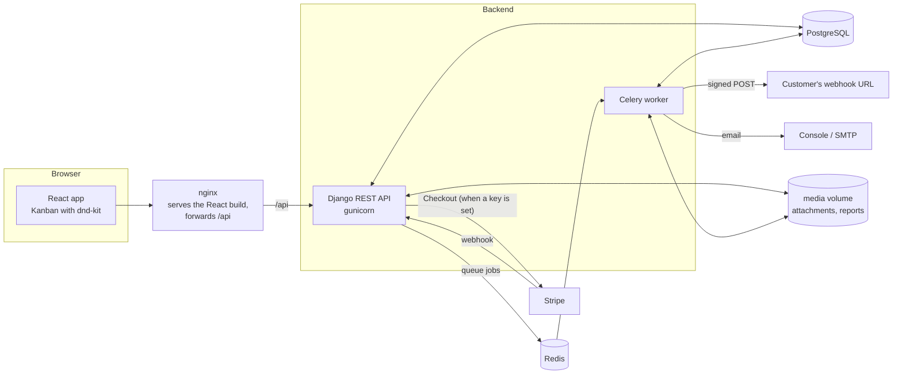
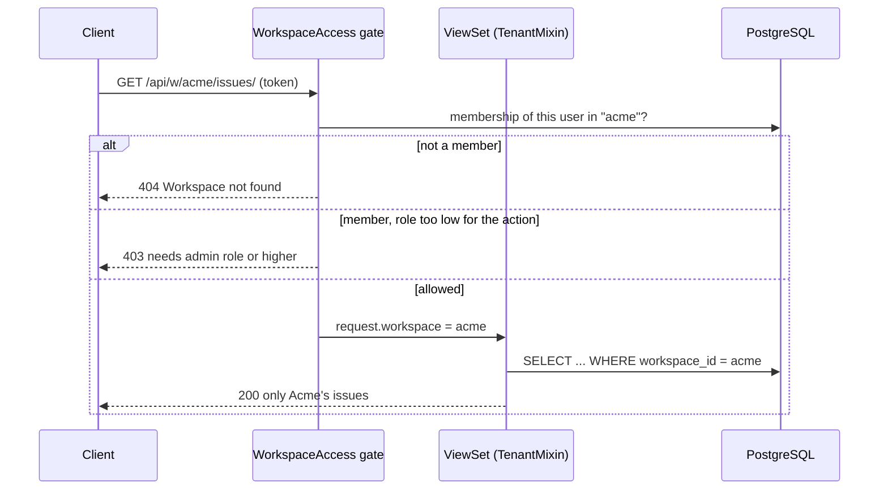
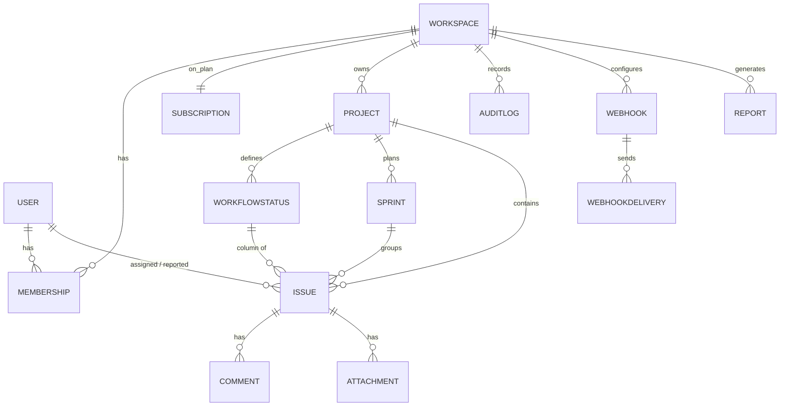
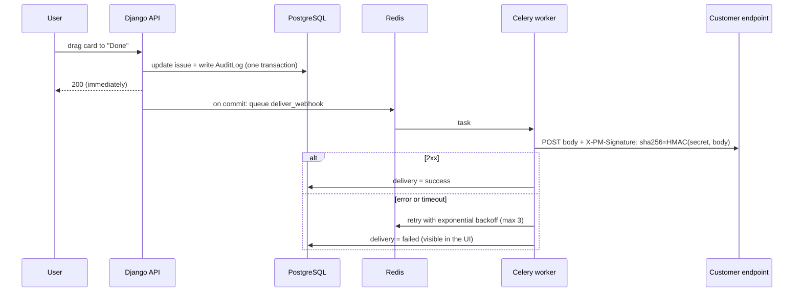
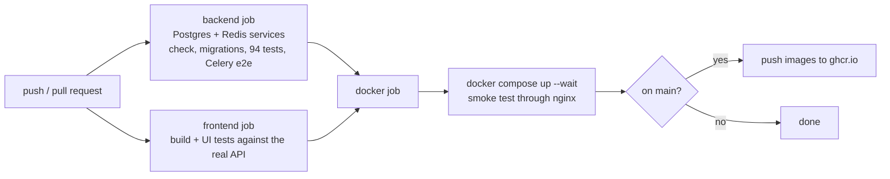

# Architecture

## System overview

## Multi-tenancy: shared schema with a `workspace` column

A **workspace is one company (a tenant)**. Every tenant-owned table (projects, statuses, sprints, issues, comments, attachments, audit log, webhooks, reports, subscriptions) has a foreign key to `Workspace`. This is the "shared schema with `tenant_id`" strategy: one database, one set of tables, cheap to run and migrate.

The isolation is enforced in **layers**, so one mistake cannot expose another company's data:

| Layer | Where | What it does |
|---|---|---|
| 1. The gate | `workspaces/permissions.py` (`WorkspaceAccess`) | Every URL is `/api/w/<slug>/...`. The caller must be a **member** of that workspace, otherwise **404** (the workspace is not even confirmed to exist). Then the role is checked against the action. |
| 2. Scoped queries | `workspaces/mixins.py` (`TenantMixin.get_queryset`) | Every viewset returns only rows with `workspace = request.workspace`. There is no other way to build a queryset. A valid id from another company is simply "not found". |
| 3. Scoped references | `WorkspaceRelatedField`, `MemberField` | A foreign key sent by the client (project, status, sprint, assignee, issue) is looked up **inside the current workspace only**. You cannot create an issue in someone else's project, assign a stranger, or move a card into another company's column. |
| 4. Scoped files | `attachments/<id>/download/`, `reports/<id>/download/` | Files are never served from a public URL. Every download passes layers 1-2. Stored names carry a random prefix. |
| 5. Scoped uniqueness | database constraints | Project keys, status names and issue numbers are unique **per workspace/project**, so two companies can both have a project `WEB`. |
| 6. Tests | `tests/test_isolation.py` | 12 tests act as an outsider against every endpoint, try cross-tenant ids and references, files, the audit log, and workspace deletion. |

**Known limit:** isolation is enforced by application code. A bug in a *new* endpoint that skipped `TenantMixin` would not be caught by the database. The next step is PostgreSQL **row-level security** as a second line of defence.

## Roles and permissions

| Action | viewer | member | admin | owner |
|---|:-:|:-:|:-:|:-:|
| Read projects, board, issues, comments, members, reports | yes | yes | yes | yes |
| Create/edit issues, move cards, comment, attach files, request reports | | yes | yes | yes |
| Delete issues | | | yes | yes |
| Projects, workflow columns and rules, sprints (create, edit, start, complete) | | | yes | yes |
| Add members, change roles, remove members | | | yes (cannot touch owners) | yes |
| Audit log, webhooks, view billing | | | yes | yes |
| Change plan, cancel, delete workspace | | | | yes |

Extra rules: a role cannot be granted above your own; only an owner grants or changes owners; the last owner cannot be demoted or removed; comments can be changed only by their author or an admin; anyone may leave a workspace.

## Data model

Design decisions:
- **Issue keys** (`WEB-12`) come from a per-project counter incremented under a row lock (`select_for_update`), so two people creating issues at once never get the same number.
- **Card order** is a float `position` inside a column. A drop computes the midpoint between its neighbours; when neighbours get too close for floating point the server renumbers the column. A test inserts 45 cards between the same two and checks the order.
- **Custom workflows:** each status can list `next_statuses`. If the list is not empty, an issue in that status may only move to those. The rule is enforced both on drag-and-drop and on normal edits.
- Issue status uses `RESTRICT` (not `CASCADE`): a status that still has issues cannot be deleted, but deleting a whole workspace still works.

## Audit log and webhooks (one mechanism)

Every create/update/delete goes through `AuditedMixin`, which writes an `AuditLog` row with the old and new values. After the database transaction **commits**, the entry is fanned out: each matching active webhook gets a `WebhookDelivery` row and a Celery task.

Why it is built this way: the user's request never waits for (or fails because of) a customer's server; events are only sent for changes that really committed; the receiver can verify the sender with the secret. Webhook URLs must be http(s), and **in production private/loopback/link-local addresses are refused** so a tenant cannot use webhooks to probe our internal network.

## Background jobs (Celery)

| Job | Trigger | Notes |
|---|---|---|
| `deliver_webhook` | any audited change | signed, retried with backoff, logged |
| `notify_assignment` | an issue is assigned to someone else | email (printed to the worker log in development) |
| `generate_report` | `POST /reports/` | returns **202**; builds a CSV and a summary in the background; formula-injection safe (cells starting with `= + - @` are neutralised) |

## Billing and plan limits

| | Free | Pro ($15/mo) | Business ($49/mo) |
|---|---|---|---|
| Projects | 2 | 10 | unlimited |
| Members | 3 | 15 | unlimited |
| Webhooks | no | yes | yes |

- Limits are checked **before** creating a project, adding a member or creating a webhook. Over the limit returns **HTTP 402** with `{"code": "plan_limit", "plan", "limit", "detail"}`; the React app turns it into an "Upgrade your plan" prompt.
- A downgrade is refused while usage exceeds the cheaper plan's limits; existing data is kept.
- **Provider switch:** with `STRIPE_SECRET_KEY` set, "upgrade" creates a Stripe Checkout subscription session and a webhook activates the plan. Without a key, a **simulated checkout** page (test card `4242 4242 4242 4242` succeeds, `4000 0000 0000 0002` is declined) calls the same activation code. The simulated endpoints return 404 when Stripe is the provider.
- Only an **owner** can open checkout, and a checkout session can only be paid by the owner of its workspace.

## Security notes

- Passwords hashed by Django (PBKDF2), minimum length and common-password checks; the same error for wrong email and wrong password.
- Token authentication; an invalid or expired token logs the React app out automatically.
- Uploads: size limit, original names reduced to the base name, random storage prefix, `Content-Disposition: attachment` and `nosniff` on download.
- CSV report cells are protected against spreadsheet formula injection.
- Secrets (Django key, Stripe key, webhook secrets) come from environment variables; the app refuses to start with the default key when `DJANGO_DEBUG=0`.

## Deployment pipeline

